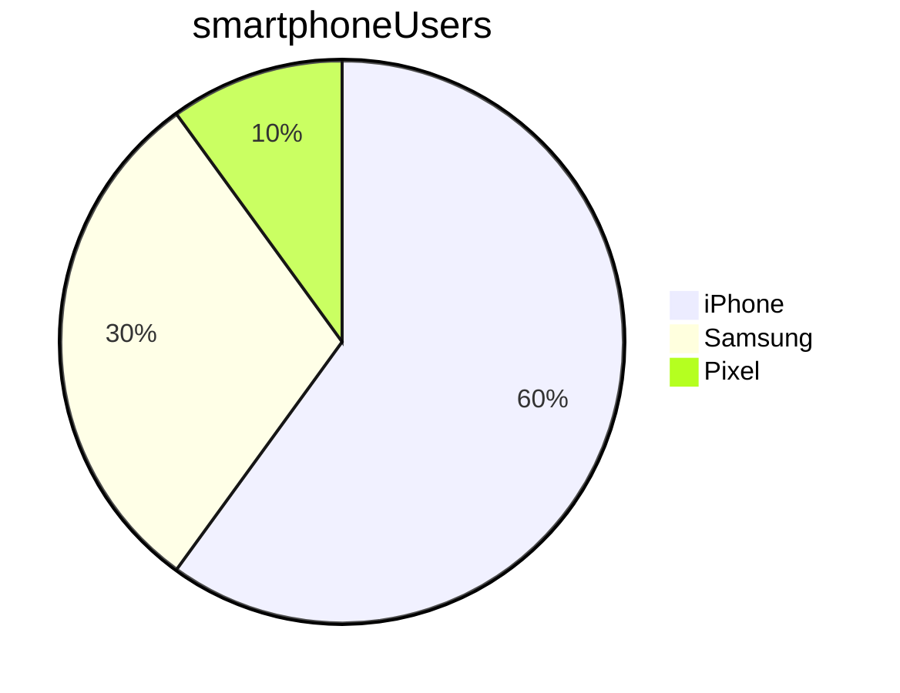

## Markdown

### Headings

More hashes = smaller heading

### Lists

Example 1

* item 1
* item 2

Example 2

1. step 1
2. step 2

Example 3

* item 1
  * sub point 1 for item 1
  * sub point 2 for item 2
* item 2
  1. step 1 for item 2
  2. step 2 for item 2

### Italics and bold

*This is in italics*

The word **bold** is in **bold**

***Mix of italics and bold***

### Images and links

This is the image embedded


This is the link (remove the ! at the beginning)
[2nd cat picture](images/cat.jpg)

### Marking code

With Python, use `print` to display text on the screen

For a block of code:
```python
print("Hello")
```

```bash
mkdir folder_to_make
```

### Task list

* [ ] task 1
* [x] task 2

### Tables


Name    |   Street   |  Town
--------|------------|----------
Cathy   | Main St    | Birmingham
John    | Maple Drive  | Stafford


### Mermaid

